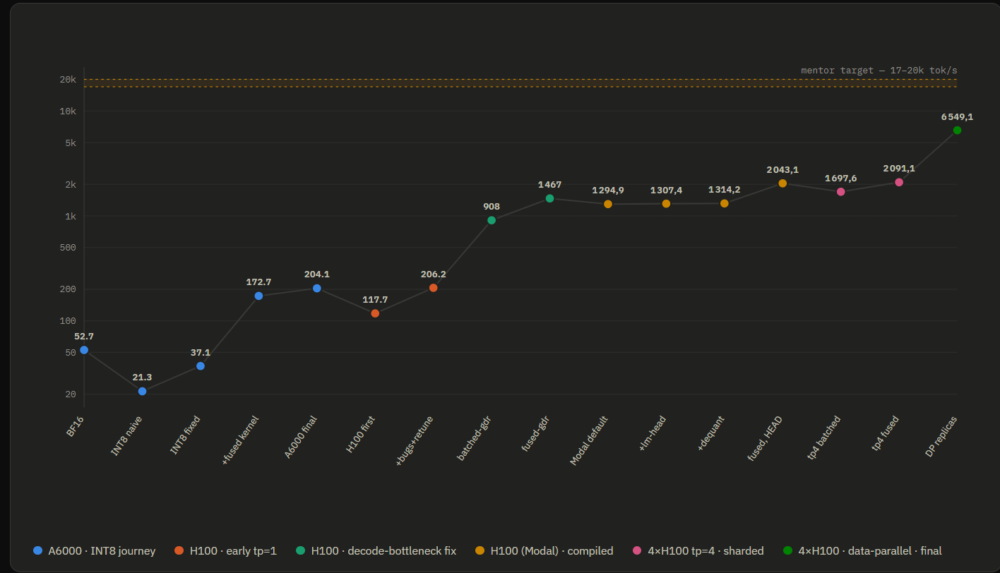

<p align="center">

</p>

# qLLM — Qwen3.5-35B-A3B Serving Engine

*A research project under the [RLS Research Lab](https://github.com/RLS-ResearchLab) umbrella, mentored by Ghassen Fatnassi.*

A from-scratch extension of [nano-vLLM](https://github.com/GeeeekExplorer/nano-vllm) that serves
**Qwen3.5-35B-A3B**, a *hybrid* architecture mixing linear attention (Gated Delta Rule), full
attention, and Mixture-of-Experts — validated end-to-end against a numerical reference on the real
34.66B-parameter checkpoint.

---

## What this is

Standard serving engines (vLLM, SGLang, nano-vLLM) assume every layer needs the same kind of
per-sequence memory: a paged KV cache that grows with context length. That holds for a dense
transformer. It doesn't hold for Qwen3.5-35B-A3B, whose 40 layers alternate two different attention
mechanisms in a fixed 4-layer block:

- **3× Gated Delta Rule linear attention** — a recurrent scan carrying a **fixed-size** per-sequence
  state (doesn't grow with context, unrelated to a KV cache).
- **1× grouped-query full attention** — needs the conventional growing, paged KV cache.

Every layer also routes through a **256-expert MoE FFN** (top-8 + 1 shared), adding its own batching
and memory-layout concerns. A scheduler/block-manager/CUDA-graph pipeline built for "one growing cache
per sequence" can't serve this without real architectural surgery — this project does that surgery on
nano-vLLM specifically because its small, auditable codebase makes it realistic to extend *correctly*
within a research-internship timeframe.

**What was built:** `StateManager` (`engine/state_manager.py`) — a fixed-size recurrent-state/conv-buffer
slot pool for the linear-attention layers, wired into the scheduler at the same points the KV-cache
block manager fires; the hybrid model itself (`models/qwen3_5.py`) with TP-aware sharding for every
GDR tensor; a batched HTTP server (`src/server.py`) with a single background thread driving the
scheduler.

This is a **correctness-and-architecture-validation** project — see [What's still open](#whats-still-open)
for what's explicitly deferred.

---

## Results

**Correctness**, cosine similarity against `src/model.py` (the validated PyTorch reference, itself
checked against HuggingFace: cosine > 0.98, top-1 5/6) unless noted:

| Check | Result |
|---|---|
| Hybrid model vs. reference (small model) | cosine 0.999970, top-1 exact |
| Eager vs. CUDA-graph decode parity | cosine 1.000000, top-1 exact |
| Real-checkpoint vs. HF reference, 5 prompts | cosine 0.9982–0.9997, 5/5 argmax match |
| Real-checkpoint decode-time slot-reuse/contamination | **not detected** — 3 independent checks |
| **GSM8K-CoT, full 1319 examples** (chat-no-think, real checkpoint) | **95.30%** (1257/1319) — PASS vs. 87.5% gate |
| MoE INT8 + fused kernel non-regression, CUDA-graph mode | **40/40, zero discordant pairs** |

**Throughput**, real 35B checkpoint, tp=2, 2×A6000 (Ampere, no NVLink — functional validation, not
H200-predictive):

| Config | tok/s |
|---|---|
| bf16, no CUDA graphs | 33.8 (concurrency=32 plateau) |
| bf16 + CUDA graphs | 52.7–54.0 |
| INT8 (weight-only) + graphs, no fused kernel | 37.1 |
| INT8 + graphs + fused Triton kernel, concurrency=32 | **204.1 — 3.87× bf16** |

**204.1 tok/s clears the 200 tok/s target on hardware not expected to reach it** — bf16 itself can't
even run at concurrency=32 (OOMs), so INT8 + a custom fused kernel unlocked the higher concurrency in
the first place, not just a faster path at the same setting. Cross-validated via two independent
harnesses and correctness-verified multiple independent ways (isolated kernel math, GSM8K
non-regression in both eager and graph mode, real generated text read under graph capture). Full
derivation — every intermediate fix, root causes, and why each number is trusted — is in
`moe_quantization_memo.md`.

<p align="center">

</p>

<p align="center"><em>Every validated milestone, log-scale, from the A6000 bf16 baseline to the current
4×H100 ceiling — see <a href="#whats-still-open">What's still open</a> for the gap to the 17-20k tok/s target.</em></p>

---

## What's still open

- **tp=4** — CPU-validated; real-hardware NCCL/HF-reference confirmation pending. Top of `H200_test_day_checklist.md`.
- **Concurrency=64 doesn't fit on 2×A6000** — real memory ceiling, not a tuning gap. Should lift on H200's 141GB.
- **Prefill** not migrated to the fused INT8 kernel — low priority (~1 of 1025 forward passes/generation).
- **INT8 weight-only + fused kernel now wired up at any `tensor_parallel_size`**, not just EP — written and CPU-reasoned only, **unvalidated on GPU**.
- **True W8A8 (activation quant) and FP8** — blocked on Ampere (no FP8 tensor cores); real candidate on H200.
- **GSM8K answer-termination edge cases** — arithmetic is right, but doesn't always emit a clean extractable answer in the token budget.
- **Batch-composition bf16 sensitivity** — argmax divergence in 2/5 long sequences tested; n=5 too small to size the rate.
- **`shared_expert` bf16 residual** (~0.6–0.8% cosine) — bounded, not yet ablated against GSM8K accuracy.
- **Prefix caching permanently disabled with `StateManager` active** — recurrent state can't be reconstructed from a cached KV prefix.
- **Round-robin MoE expert sharding** — no measured expert-utilization histogram behind the choice.
- **Two narrow gaps** — `load_model()` only accepts split/HF param names, not a fused native name; `LLMEngine`'s `atexit` lifecycle keeps every instance alive until process exit (`del engine` alone doesn't free GPU memory).

See `H200_test_day_checklist.md` for the prioritized plan going into the next hardware window.

---

## Repository layout

```
engine/          sequence.py, block_manager.py, scheduler.py,
                 model_runner.py, llm_engine.py, state_manager.py
layers/          linear.py, attention.py, layernorm.py,
                 rotary_embedding.py, embed_head.py, sampler.py, activation.py
models/
  qwen3.py       existing dense Qwen3 model — untouched
  qwen3_5.py     hybrid Qwen3.5 model (this project)
utils/           context.py, loader.py

src/
  model.py               ground-truth PyTorch reference for Qwen3.5-35B-A3B
  model_small_qwen3.5.py ~290M-param scaled-down variant, same architecture
  server.py              OpenAI-compatible server, FCFS or batched mode

tests/           correctness suites — see "Running the test suites" below
                 (incl. gsm8k_full_run.py — GSM8K-CoT correctness gate)
bench_throughput.py       concurrency-sweep throughput harness (internal engine)
bench_http_concurrency.py concurrency-sweep throughput harness (HTTP server)

outputs/         gitignored — server/bench logs, CSVs, and profiler traces
                 (nsys, sqlite) from *_test.sh / *_session.sh driver scripts,
                 grouped by run. Nothing in here is committed; see below.
```

### Run artifacts (`outputs/`)

The `*.sh` driver scripts at the repo root (`h100_session.sh`, `final_test_tp4.sh`,
`ddp_replicas_test.sh`, `tune_decode_moe.sh`, `profile_milestones.sh`) each produce
server logs, bench logs/CSVs, and — for profiling runs — `nsys`/`sqlite` traces. All
of that lands under `outputs/<script>/<run-variant>/` and is gitignored, so the repo
root stays limited to source and tooling. `.gitignore` also blanket-ignores `*.csv`,
`*.log`, `*.zip`, `*.nsys-rep`, `*.sqlite`, `*_trace*.json`, and `*.md` (with `README.md`
and `PICKED_MILESTONES.md` explicitly kept) — curated write-ups like
`moe_quantization_memo.md`, `THROUGHPUT_PUSH_CHECKLIST.md`, and the `SESSION_HANDOFF_*.md`
files stay local reference material rather than tracked docs.

---

## Setup

```bash
git clone <this-repo>
cd qLLM
pip install -r requirements.txt          # or: pip install git+https://github.com/GeeeekExplorer/nano-vllm.git
```

For the real Qwen3.5-35B-A3B checkpoint (~67GB, bf16) — no install script ships
in this repo yet, so fetch it manually, e.g. via `huggingface_hub`:

```bash
python -c "from huggingface_hub import snapshot_download; \
    snapshot_download('Qwen/Qwen3.5-35B-A3B', local_dir='./qwen35_checkpoint')"
```

Point `--model` (server) or `LLM(...)` (programmatic) at that local directory.

---

## Running the engine

**Start the server (batched mode — recommended; FCFS is the legacy default):**

```bash
python -m src.server \
    --model /path/to/Qwen3.5-35B-A3B \
    --tensor-parallel-size 2 \
    --concurrency-mode batched \
    --max-num-seqs 8 \
    --enforce-eager \
    --gpu-memory-utilization 0.85
```

**Query it (OpenAI-compatible):**

```bash
curl http://localhost:8000/v1/chat/completions \
    -H "Content-Type: application/json" \
    -d '{
      "model": "qwen3.5-35b-a3b",
      "messages": [{"role": "user", "content": "What is the capital of France?"}],
      "temperature": 0,
      "max_tokens": 64
    }'
```

**Programmatic (engine-internal, no HTTP layer):**

```python
from nanovllm import LLM, SamplingParams

llm = LLM(
    "/path/to/Qwen3.5-35B-A3B",
    tensor_parallel_size=2,
    enforce_eager=True,
    gpu_memory_utilization=0.85,
)
sampling_params = SamplingParams(temperature=0, max_tokens=256)
outputs = llm.generate(["Explain the GDR scan in one sentence."], sampling_params)
print(outputs[0]["text"])
```

---

## Running the test suites

```bash
# Component + full-model correctness vs. reference (CPU-friendly)
python tests/test_qwen35_standalone.py

# Batching / StateManager acceptance (requires CUDA + flash-attn)
python tests/test_qwen35_batching.py

# ModelRunner construction, KV-cache byte accounting
python tests/make_fake_hf_config.py
python tests/test_qwen34_model_runner.py

# Eager vs. graph-replay decode parity
python tests/cuda_graph_consistency_test.py

# Real-checkpoint decode-time slot-reuse safety
python tests/decode_stagger_contamination_check.py            # fake model, seconds
python tests/real_checkpoint_slot_reuse_check.py               # forces reuse (--max-num-seqs 3)
python tests/real_checkpoint_slot_reuse_check.py --max-num-seqs 8   # no-reuse control

# TP=2 shard-selection math (CPU-only, no GPU required)
python tests/test_tp_shard_loader.py
```

## Running the benchmarks

```bash
# Internal-engine throughput sweep, small model (mechanism validation only —
# absolute tok/s is not meaningful at this scale)
python bench_throughput.py --model tests/fake_qwen35_small \
    --prompt-len 32 --output-len 64 --max-model-len 512 --gpu-memory-utilization 0.2

# HTTP-server throughput sweep, real checkpoint, real 1024-out target
# (--tokenizer-dir is required -- used for the retok spot-check, see script header)
python bench_http_concurrency.py \
    --base-url http://localhost:8000 \
    --tokenizer-dir /path/to/Qwen3.5-35B-A3B \
    --levels 1 2 4 8 16 32 64 \
    --prompt-tokens 1024 --max-tokens 1024 \
    --ignore-eos \
    --trials 2 --warmup-trials 1

# GSM8K-CoT correctness gate (all 1319 examples, batches of 8, temperature=0,
# checkpointed -- safe to re-run after a crash, resumes from RESULTS_PATH)
python tests/gsm8k_full_run.py --stop-strings
```

---

## Ground rules for contributors

- Do not modify `models/qwen3.py` or break the existing dense-Qwen3 path —
  the hybrid model is a fully separate model file.
- Do not modify `src/model.py`. It is the numerical ground truth for every
  formula. If the port disagrees with it, `src/model.py` wins.
- Prefer small, reviewable diffs per phase over one large rewrite; don't
  start a new phase until the previous phase's acceptance criteria pass.
- Report actual validation numbers (cosine similarity, top-1/top-5 match,
  memory before/after) after each change, not just pass/fail.
